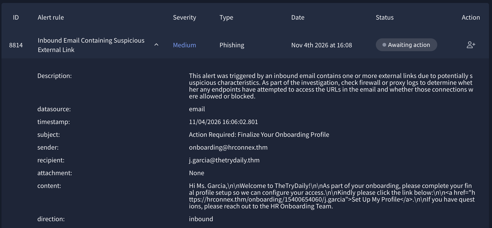
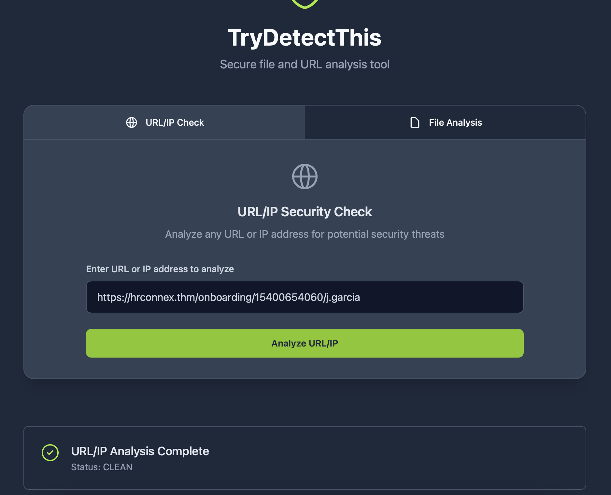
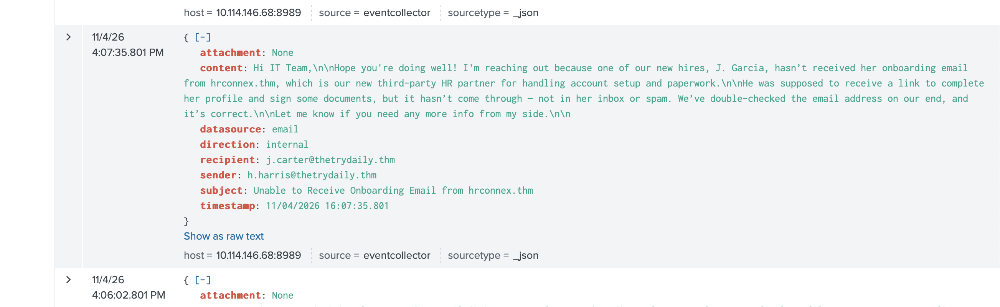
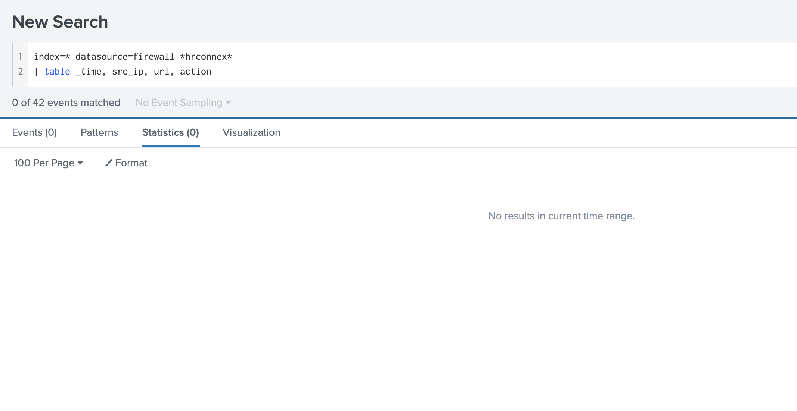

# SOC Alert Investigation: Suspicious External Link (Alert 8814)

**Environment:** TryHackMe SOC Simulator (lab data, no real users or organisations)
**Tools:** Splunk (SIEM), TryDetectThis (URL/IP/file reputation)

## Alert overview

| Field | Value |
|---|---|
| Alert ID | 8814 |
| Rule | Inbound Email Containing Suspicious External Link |
| Severity (per SIEM rules) | Medium |
| Type | Phishing |
| Alert time | Nov 4, 2026, 16:08 |
| **Verdict** | **False positive** |

## Summary

The alert fired for an inbound email from `onboarding@hrconnex[.]thm` to `j.garcia@thetrydaily[.]thm` (subject: "Action Required: Finalize Your Onboarding Profile", no attachment) because it contained an external link.

After reviewing the email, the link, the related Splunk email logs and the firewall logs, I found internal evidence that the sender is the company's approved third-party HR partner. I classified the alert as a false positive.

## Investigation steps

### 1. Email details
- The sender domain is external to the recipient's company, as expected for a third-party platform.
- The message is polite and asks a new employee to finish her profile setup. It has minimal urgency (the subject says "Action Required", which is normal for onboarding), no threats and no credential requests.
- No attachment.

### 2. Link check
- The link uses HTTPS and the same domain as the sender (`hrconnex[.]thm`). HTTPS alone is not proof of legitimacy, so this was only a supporting point.
- I checked the exact URL from the email in TryDetectThis. Result: **CLEAN**.

### 3. SIEM correlation (Splunk, email logs)
- I searched mailbox activity around the alert time.
- At 16:07:35, an internal email from `h.harris@thetrydaily[.]thm` to `j.carter@thetrydaily[.]thm` ("Unable to Receive Onboarding Email from hrconnex[.]thm") states that `hrconnex[.]thm` is the company's new third-party HR partner and that the new hire had not yet received her onboarding email.

### 4. Firewall check (Splunk)
- I searched firewall logs for any connection to `hrconnex[.]thm`.
- No events were found, so there is no evidence that any endpoint attempted to access the link.

## Findings

- The sender domain is a known, approved third-party HR vendor, based on an internal email.
- The email matches a real, expected onboarding process.
- The URL has no malicious reputation, and the link domain matches the sender.
- No attachment, no credential request, minimal urgency.
- No firewall activity to the link's domain, so no sign of user interaction.

## Verdict

**False positive.** No escalation needed. Alert closed with notes.

## MITRE ATT&CK

Considered **T1566.002 (Phishing: Spearphishing Link)** and ruled it out based on the evidence above.

## Recommendations

- Confirm the vendor with HR (or a vendor list) through a separate channel, since my verification relied on one internal email.
- If approved, add `hrconnex[.]thm` to the allowlist to reduce repeat false positives.
- Monitor for lookalike domains impersonating the vendor.

