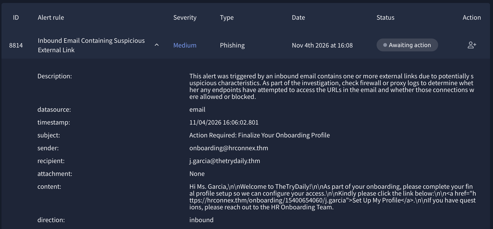
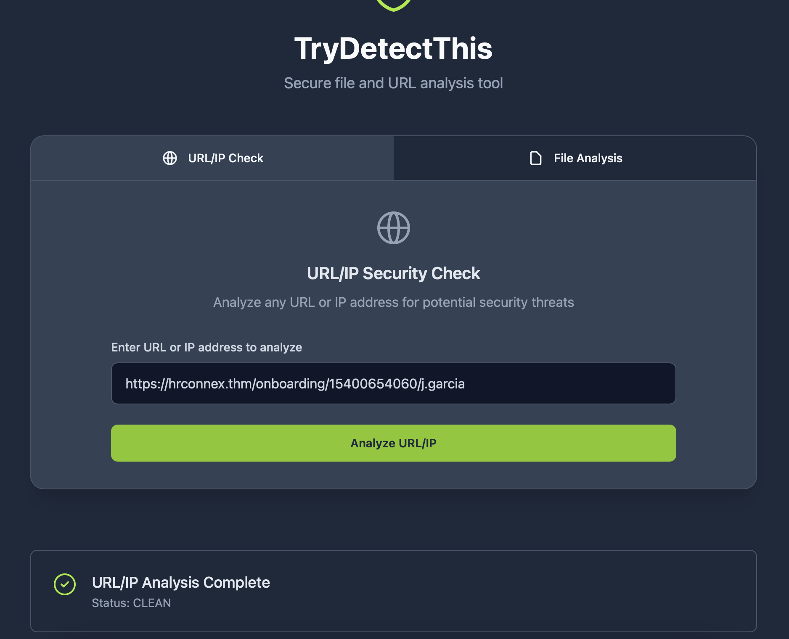
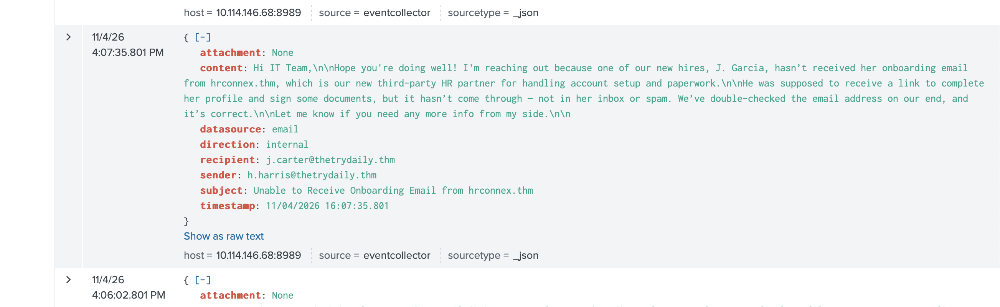
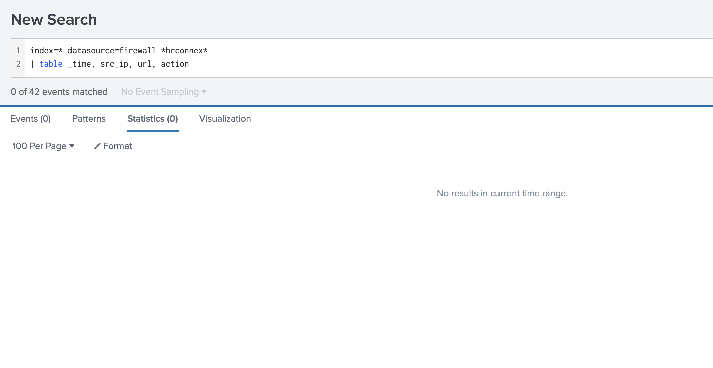
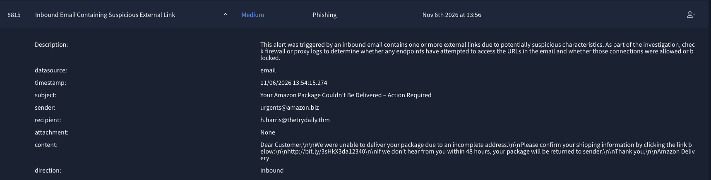
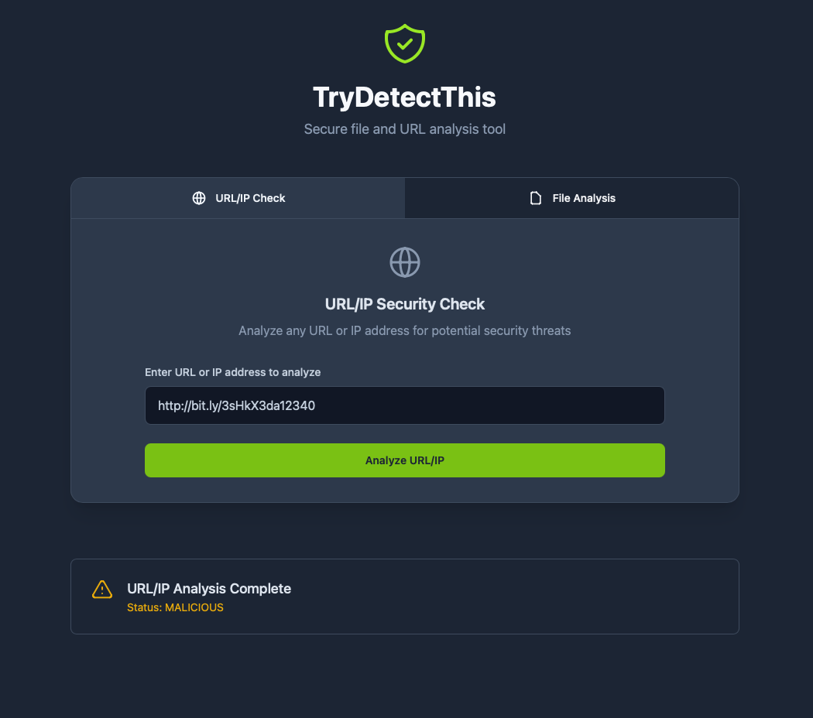
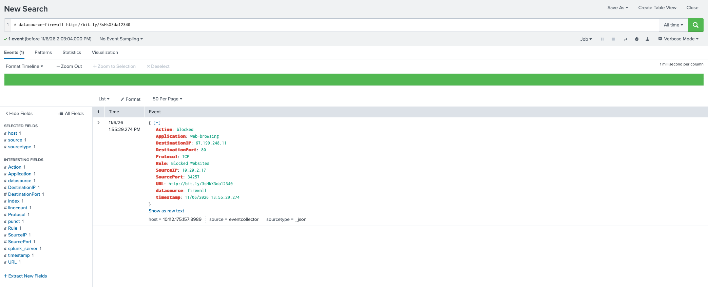
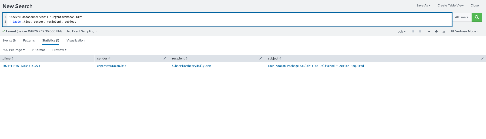
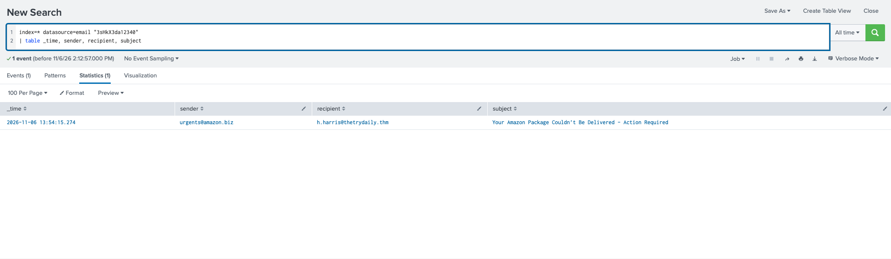

# Phishing Alerts

**Source:** TryHackMe SOC Simulator (lab data) | **Tools:** Splunk, TryDetectThis

| Alert | Date | Severity | Verdict | Summary |
|---|---|---|---|---|
| 8814 | Nov 4, 2026 | Medium | **False positive** | Approved third-party HR vendor, clean link, no firewall activity |
| 8815 | Nov 6, 2026 | Medium | **True positive** | Fake Amazon sender, malicious shortened link, connection attempt blocked |

---

## Alert 8814: False positive

| Field | Value |
|---|---|
| Rule | Inbound Email Containing Suspicious External Link |
| Alert time | Nov 4, 2026, 16:08 |
| Sender | `onboarding@hrconnex[.]thm` |
| Recipient | `j.garcia@thetrydaily[.]thm` |
| Subject | Action Required: Finalize Your Onboarding Profile |
| Attachment | None |

**Case note**

Closed as false positive. Inbound onboarding email from `hrconnex[.]thm` to a new employee, with a link to the same domain. The sender is the company's new HR vendor, confirmed by an internal email at 16:07 from `h.harris`. The link is clean in TryDetectThis, there is no attachment, and there are no firewall connections to the domain. No action needed. Suggest HR confirms the vendor and the domain is allowlisted.

**Evidence**

- **Email:** external sender, polite tone, minimal urgency, no threats, no credential request, no attachment.
- **Link:** HTTPS, same domain as the sender. TryDetectThis result for the exact URL: clean.

- **Splunk (email logs):** at 16:07:35, `h.harris@thetrydaily[.]thm` wrote to `j.carter@thetrydaily[.]thm` ("Unable to Receive Onboarding Email from hrconnex[.]thm") saying `hrconnex[.]thm` is the new third-party HR partner and the new hire had not received her onboarding email.

- **Splunk (firewall logs):** no connections to `hrconnex[.]thm`.

**Verdict:** false positive. No escalation.

**Actions**
- Confirm the vendor with HR through a separate channel, since the verification rests on one internal email.
- If approved, add `hrconnex[.]thm` to the allowlist.

**MITRE ATT&CK:** T1566.002 considered, not supported by the evidence.

---

## Alert 8815: True positive

| Field | Value |
|---|---|
| Rule | Inbound Email Containing Suspicious External Link |
| Alert time | Nov 6, 2026, 13:56 |
| Sender | `urgents@amazon[.]biz` |
| Recipient | `h.harris@thetrydaily[.]thm` |
| Subject | Your Amazon Package Couldn't Be Delivered - Action Required |
| Attachment | None |
| Link | `hxxp://bit[.]ly/3sHkX3da12340` |

**Case note**

Closed as true positive. Fake Amazon delivery email from `amazon[.]biz` to `h.harris`, with a shortened link that TryDetectThis rates malicious. Internal host `10.20.2.17` tried to open the link 74 seconds after delivery and the firewall blocked it. Only one recipient found. No evidence of compromise in the available data, so no incident escalation. Actions: block the sender domain, remove the email, warn the user, check `10.20.2.17` for other activity.

**Evidence**

- **Sender:** `amazon[.]biz` is not an Amazon domain. Generic greeting ("Dear Customer"), delivery pretext, 48-hour deadline.
- **Link:** unencrypted HTTP, URL shortener (final destination hidden), does not match the sender. TryDetectThis: malicious.

- **Firewall:** at 13:55:29, source `10.20.2.17` to `67.199.248.11` port 80 (TCP, web-browsing), action blocked, rule "Blocked Websites".

- **Scope:** searches for the sender and for the link each returned one email, the one to `h.harris`.

**Verdict:** true positive, connection blocked. No escalation of an incident.

**Actions**
- Block `amazon[.]biz` at the email gateway.
- Remove the email from the mailbox.
- Warn the user and confirm whether they clicked.
- Check `10.20.2.17` for other unusual activity.
- Escalate if other recipients or any allowed connection to the link are found.

**Not confirmed**
- That `10.20.2.17` is the recipient's machine (the firewall log has no user name).
- The final destination of the shortened link.
- Whether the "Blocked Websites" rule blocked this link specifically or shortened links in general.

**MITRE ATT&CK:** T1566.002

**IOCs:** `urgents@amazon[.]biz`, `hxxp://bit[.]ly/3sHkX3da12340`

